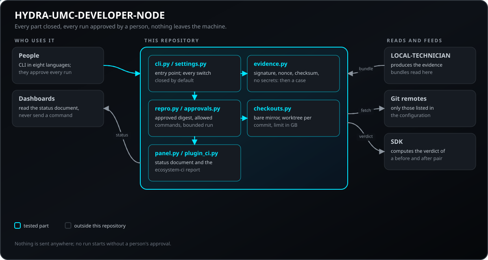
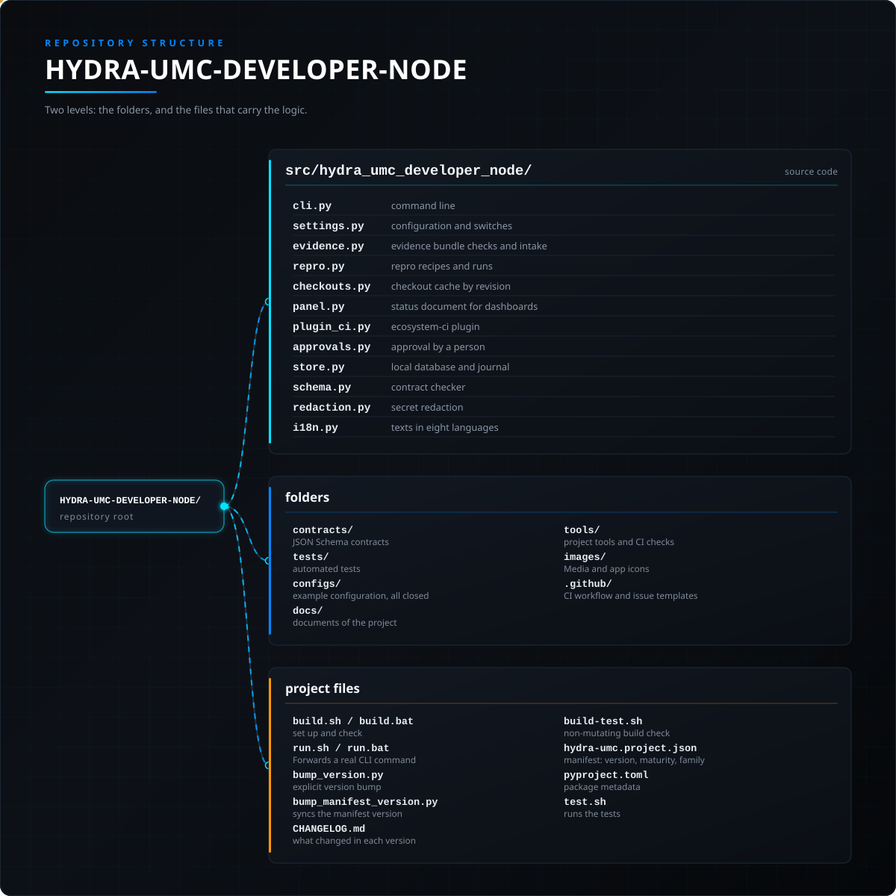

<!-- =============================================================================
HYDRA-UMC-DEVELOPER-NODE - Developer node: evidence, repro cases and checkouts, approved by a person
Copyright (C) JuanenRac (Electro Hobby 3D) <electrohobby3d@gmail.com>
GPL-3.0-or-later - see LICENSE
============================================================================= -->

<p align="center">
  
</p>

# 🧑‍💻 HYDRA-UMC-DEVELOPER-NODE

<p align="center"><a href="README.md">🇺🇸 English</a> | <a href="README_spa.md">🇪🇸 Español</a> | <a href="README_fra.md">🇫🇷 Français</a> | 🇮🇹 <b>Italiano</b> | <a href="README_deu.md">🇩🇪 Deutsch</a> | <a href="README_zho.md">🇨🇳 简体中文</a> | <a href="README_jpn.md">🇯🇵 日本語</a> | <a href="README_por.md">🇵🇹 Português</a></p>

### 🧑‍💻 Nodo di sviluppo: studia i guasti, li riproduce e non esegue nulla senza approvazione

<p align="center">
  
  
  
  
  
  
  
</p>

---

**Verifica di onestà - cosa funziona oggi:** l'acquisizione delle prove (firma, nonce, checksum, controllo dei segreti), i casi di riproduzione eseguibili con approvazioni legate a un'impronta, la cache dei checkout con il suo limite, il documento di stato, il plugin `ecosystem-ci` e i testi in otto lingue sono reali e testati (95 test automatici, con repository git locali e processi locali). Il nodo non ha girato su un vero host di sviluppo, una ricetta non è isolata oltre a un elenco di ammessi e un ambiente minimo, e nulla prende lavoro dalla coda da solo. Vedi `CHANGELOG.md` per ciò che è stato consegnato esattamente.

---

> **Stato di sicurezza (safety e security):** questo ecosistema non è un sistema di sicurezza certificato. Non esiste ancora un percorso E-STOP hardware, né limiti o interblocchi imposti dal firmware, né un comando di movimento verificato; le immagini firmware sono controllate con CRC-32 e una firma Ed25519, e una compilazione di rilascio rifiuta le chiavi di sviluppo pubblicate (le teste utensile e le schede di espansione dietro il relè usano ancora i bootloader di URTC, che accettano un HMAC-SHA256 a chiave condivisa invece di una firma); TLS e TLS reciproco sono opzionali e disattivati per impostazione predefinita; nessuna scheda propria è stata ancora assemblata o provata. Leggi la [base di sicurezza](https://github.com/JuanenRac/HYDRA-UMC-DOCS/blob/main/docs/SECURITY_BASELINE.md) e il [modello delle minacce](https://github.com/JuanenRac/HYDRA-UMC-DOCS/blob/main/docs/THREAT_MODEL.md) prima di fidarti di qualsiasi affermazione qui per la sicurezza di una persona.

---

## 📋 In breve

| | |
|---|---|
| Versione | `0.0.3` |
| Maturità | Impalcatura |
| Test | 95 (`python -m pytest -q tests`) |
| Tecnologia | Python 3.11+ / JSON Schema / SQLite / git worktree |
| Destinazione | Un server di sviluppo |
| Su hardware reale | Non applicabile: nulla qui gira su hardware |

**Vai a:** [Panoramica](#-panoramica) · [Architettura](#-architettura) · [Avvio rapido](#-avvio-rapido) · [Test](#-test) · [Struttura del repository](#-struttura-del-repository) · [Progetti correlati](#-progetti-correlati)

## 🚦 Stato del progetto

Ogni riga è una parte di questo repository e il semaforo dice a che punto è oggi. È scritta in base a ciò che il repository può mostrare (test, compilazioni, esecuzioni), non a ciò che è previsto.

🟢 Fatto e verificato · 🟡 Funziona, con limiti noti · 🟠 Fatto a metà o non ancora verificato · 🔴 Non fatto o non funzionante

| Area | Stato | Cosa significa qui |
|---|---|---|
| Software | 🟠 | Solo struttura e primi pezzi; gran parte del lavoro è ancora da fare |
| Test | 🟡 | 95 test automatici, eseguiti a ogni modifica |
| Hardware reale | 🟡 | Non applicabile: nulla qui gira su hardware |
| Interfaccia e protocolli | 🟡 | Le rotte o i messaggi offerti sono documentati e provati con un client; non tutti i client li hanno ancora usati |
| Integrazione | 🟡 | I suoi messaggi e le sue rotte sono verificati rispetto ai contratti condivisi dell'SDK; non ha ancora funzionato insieme all'apparecchiatura reale |
| Sicurezza | 🟡 | Il controllo degli accessi, i limiti d'ingresso o le firme sono implementati e provati su un computer; nessuno al di fuori del progetto li ha rivisti |
| Esercizio | 🟠 | Scrive log; non ha ancora un endpoint di metriche o di stato |
| Documentazione | 🟡 | README in otto lingue, verificato rispetto al manifesto a ogni modifica |

## 🎯 Panoramica

HYDRA-UMC-DEVELOPER-NODE è il nodo di sviluppo dell'ecosistema: il luogo in cui si studia un guasto segnalato da un nodo. Legge il pacchetto di prove di `HYDRA-UMC-LOCAL-TECHNICIAN` (in sola lettura), ottiene il codice esatto della revisione coinvolta da una cache di worktree git, riproduce il guasto con una ricetta fissa e può eseguire la CI condivisa su uno spazio di lavoro.

Quattro regole valgono ovunque. Ogni parte è **chiusa** finché il file di configurazione non la apre. Nulla viene eseguito senza che **una persona approvi esattamente ciò che verrà eseguito**. Nulla **lascia la macchina**. Ogni valore regolabile sta nel **file di configurazione**, mai nel codice.

Questa versione include cinque parti indipendenti:

1. **Acquisizione delle prove** (`evidence.py`) - verifica un pacchetto o un messaggio firmato `incident-transport/1` (firma, destinatario, età, nonce, forma, checksum, nessun segreto) e lo salva come un caso che attende una persona.
2. **Casi di riproduzione eseguibili** (`repro.py`, `approvals.py`) - una ricetta di liste di argomenti, solo comandi ammessi e un'approvazione legata alla sua impronta; ogni esecuzione è un `ScenarioOutcome` dell'SDK e l'SDK dà il verdetto di una coppia prima e dopo.
3. **Cache dei checkout per revisione** (`checkouts.py`) - un mirror bare e un worktree git per commit, il commit fissato viene verificato, un limite in GB è mantenuto rimuovendo i worktree usati meno di recente.
4. **Documento di stato** (`panel.py`) - coda, registro e stato di salute per un pannello o uno studio, in otto lingue, come file.
5. **Plugin `ecosystem-ci`** (`plugin_ci.py`) - il validatore CI condiviso di ogni repository di uno spazio di lavoro, con un rapporto consolidato. Nella modalità completa (chiusa per impostazione predefinita) può anche eseguire il test pesante che ogni repository dichiara, come un lotto che una persona approva tramite la sua impronta, un repository alla volta, con limiti di tempo, di output e di spazio libero su disco.

## 🧩 Ruolo in HYDRA-UMC

**HYDRA-UMC-DEVELOPER-NODE** è il nodo di sviluppo dell'ecosistema: legge i pacchetti di prove di `HYDRA-UMC-LOCAL-TECHNICIAN`, mantiene una cache di checkout per revisione, esegue ricette di riproduzione e la CI condivisa, e ognuna di queste parti resta chiusa finché la configurazione non la apre e una persona non approva l'esecuzione esatta.

## 🏛️ Architettura

<p align="center">
  
</p>

## 🚀 Avvio rapido

Richiede Python 3.11 o successivo.

```bash
./build.sh  # Linux, macOS (build.bat on Windows)
./run.sh
./run.sh --config configs/developer-node.json evidence verify bundle.json
```

## 🧪 Test

95 test automatici si eseguono con `python -m pytest -q tests`. Non richiedono hardware né nulla al di fuori di questa macchina.

La CI esegue `HYDRA_UMC_CI=1 python tools/ci_validate.py`, che controlla il manifesto, i documenti, gli otto README e le immagini.

## 🏗️ Compilazione e rilascio

```bash
chmod +x build.sh   # una sola volta
./build.sh          # crea .venv, pip install -e ".[dev]", verifica la compilazione ed esegue i test
./run.sh            # verifica la configurazione inclusa (tutti gli interruttori chiusi)
./run.sh --config configs/developer-node.json evidence verify bundle.json
./run.sh --version
```

Su Windows: `build.bat`, poi `run.bat`. `test.sh` / `test.bat` eseguono i test e i controlli senza cambiare la versione. Il verdetto di una coppia prima e dopo richiede l'SDK: `pip install -e ".[dev,sdk]"`.

**Risoluzione dei problemi**

- `Rifiutato: ... is closed`: la parte è spenta. Aprila nel file di configurazione (`"enabled": true`, un vero booleano) e leggi [docs/CONFIGURATION.md](docs/CONFIGURATION.md).
- `no valid approval for this exact recipe`: approva di nuovo la ricetta con `repro approve`; un'approvazione scade e vale una sola volta.
- `an approval needs a person at a terminal`: fai l'approvazione in un terminale, non da uno script o da una pipe.

## 📂 Struttura del repository

<p align="center">
  
</p>

<details>
<summary>Versione testuale dell'albero</summary>

```text
HYDRA-UMC-DEVELOPER-NODE/
├── src/hydra_umc_developer_node/   codice sorgente
│   ├── cli.py                      riga di comando
│   ├── settings.py                 configurazione e interruttori
│   ├── evidence.py                 verifica e acquisizione delle prove
│   ├── repro.py                    ricette di riproduzione ed esecuzioni
│   ├── checkouts.py                cache dei checkout per revisione
│   ├── panel.py                    documento di stato per i pannelli
│   ├── plugin_ci.py                plugin ecosystem-ci
│   ├── plugin_full.py              modalità completa del plugin ecosystem-ci
│   ├── approvals.py                approvazione di una persona
│   ├── store.py                    database locale e registro
│   ├── schema.py                   verifica dei contratti
│   ├── redaction.py                oscuramento dei segreti
│   └── i18n.py                     testi in otto lingue
├── contracts/                      contratti JSON Schema
├── tests/                          test automatici
├── configs/                        configurazione di esempio, tutto chiuso
├── docs/                           documenti del progetto
├── tools/                          strumenti del progetto e controlli della CI
├── images/                         Media e icone dell'app
├── .github/                        workflow di CI e modelli di segnalazione
├── build.sh / build.bat            venv + installazione editabile + verifica + test
├── run.sh / run.bat                Inoltra un comando CLI reale
├── bump_version.py                 Incremento di versione stile contachilometri (eseguito solo dal comando `bump` esplicito)
├── bump_manifest_version.py        Sincronizza la versione di hydra-umc.project.json con quella nativa (--sync)
├── CHANGELOG.md                    cosa è cambiato in ogni versione
├── build-test.sh                   controllo di build senza modifiche
├── hydra-umc.project.json          manifesto: versione, maturità, famiglia
├── pyproject.toml                  metadati del pacchetto
└── test.sh                         esegue i test
```

</details>

## 🗺️ Roadmap e limiti noti

**Limiti noti oggi**

Questa versione include le cinque parti sopra. Cosa non c'è ancora:

- **Isolamento di un'esecuzione.** Una ricetta viene eseguita con i diritti dell'utente che esegue il nodo, con un elenco di programmi ammessi, un ambiente minimo e limiti di tempo e di output; non c'è ancora una sandbox (container, namespace). Una persona deve leggere una ricetta prima di approvarla.
- **Un'approvazione più forte.** Un'approvazione è un record nel database locale fatto in un terminale; non è firmata con una chiave di chi approva.
- **Il pannello dall'altra parte.** Il documento di stato è un contratto e un file; `HYDRA-UMC-DASHBOARD-AI` e `HYDRA-UMC-STUDIO` non lo mostrano ancora, e come il file arriva a loro (un tunnel autenticato) lo decidono loro.
- **Un ciclo di lavoro.** Casi, ricette e checkout si usano con i comandi; nulla prende un caso dalla coda e lo lavora da solo, di proposito.
- **Un'esecuzione su un vero host di sviluppo.** Il nodo è stato provato solo su un computer con repository git locali.

## 🌍 Lingue

Questo README e i documenti del repository esistono in otto lingue: inglese, spagnolo, tedesco, francese, italiano, giapponese, cinese e portoghese (Portogallo). Sono scritti insieme e la CI verifica che gli otto file abbiano le stesse sezioni e gli stessi link. Questo repository non ha uno schermo né un catalogo di messaggi propri, quindi non ci sono stringhe di interfaccia da tradurre.

## 🔗 Progetti correlati

Questo progetto fa parte dell'ecosistema robotico HYDRA-UMC dello stesso autore (JuanenRac / Electro Hobby 3D). Vale la pena conoscerlo, poiché una richiesta potrebbe in realtà riguardare uno di questi invece di questo repository.

**Direttamente Correlati**
- **[HYDRA-UMC-LOCAL-TECHNICIAN](https://github.com/JuanenRac/HYDRA-UMC-LOCAL-TECHNICIAN)** — produce i pacchetti di prove che questo nodo legge; il nodo si limita a verificarli e salvarli, senza mai modificarli né eseguire ciò che dicono.
- **[HYDRA-UMC-DEV-SERVER](https://github.com/JuanenRac/HYDRA-UMC-DEV-SERVER)** — host di sviluppo riproducibile con una coda di attività duratura; questo nodo è il luogo più leggero dove si studia e si riproduce un guasto dopo l'approvazione di ogni esecuzione da parte di una persona.
- **[HYDRA-UMC-OPS-AGENT](https://github.com/JuanenRac/HYDRA-UMC-OPS-AGENT)** — gestisce il ciclo di vita degli incidenti di manutenzione (prove, diagnosi, modifica approvata da una persona, rilascio canary, verifica); questo nodo fornisce il passo di riproduzione e non approva mai una modifica.
- **[HYDRA-UMC-SDK](https://github.com/JuanenRac/HYDRA-UMC-SDK)** — i contratti condivisi: l'esito di scenario di ogni esecuzione di riproduzione segue il suo schema, e l'SDK calcola il verdetto di una coppia prima e dopo.

**Fa Anche Parte dell'Ecosistema**

*Hardware e Piattaforma di Base*
- **[HYDRA-UMC](https://github.com/JuanenRac/HYDRA-UMC)** — il progetto della scheda madre del braccio robotico: host NVIDIA Jetson Orin NX + STM32H757 dual-core (la CM5 resta il banco pilota), pensato per coordinare fino a 8 bracci utensile via CAN-OTA/SPI-OTA (firmware in fase iniziale; nessuna scheda assemblata per ora).
- **[HYDRA-UMC-OS](https://github.com/JuanenRac/HYDRA-UMC-OS)** — livello prodotto riproducibile su Raspberry Pi OS per il CM5: agente in sola lettura, config/profili validati, provisioning WiFi al primo contatto.

*Backend Centrale e Client*
- **[HYDRA-UMC-SERVER](https://github.com/JuanenRac/HYDRA-UMC-SERVER)** — il vero backend headless (REST/WebSocket) con cui parla davvero ogni client di controllo.
- **[HYDRA-UMC-STUDIO](https://github.com/JuanenRac/HYDRA-UMC-STUDIO)** — dashboard di controllo web con visualizzazione 3D multi-robot in tempo reale.
- **[HYDRA-UMC-SUITE](https://github.com/JuanenRac/HYDRA-UMC-SUITE)** — centro di comando sciame desktop (PySide6) per più server contemporaneamente.
- **[HYDRA-UMC-ANDROID-CONTROL](https://github.com/JuanenRac/HYDRA-UMC-ANDROID-CONTROL)** — app di controllo nativa per Android con login biometrico e un companion Wear OS abbinato.
- **[HYDRA-UMC-IOS-CONTROL](https://github.com/JuanenRac/HYDRA-UMC-IOS-CONTROL)** — app di controllo per iOS/iPadOS (Flutter) con sincronizzazione WebSocket in tempo reale.
- **[HYDRA-UMC-DSI](https://github.com/JuanenRac/HYDRA-UMC-DSI)** — interfaccia touch nativa per il touchscreen DSI da 7" a bordo, incorporata direttamente nel CM5.
- **[HYDRA-UMC-EDITOR-URDF](https://github.com/JuanenRac/HYDRA-UMC-EDITOR-URDF)** — creatore/editor grafico desktop di URDF che invia i modelli finiti al catalogo di STUDIO.
- **[HYDRA-UMC-EDITOR-STL](https://github.com/JuanenRac/HYDRA-UMC-EDITOR-STL)** — editor desktop di modelli STL, che trasforma/sostituisce/rimuove/aggiunge veri pezzi nello stesso catalogo di modelli modificato anche da HYDRA-UMC-EDITOR-URDF.
- **[HYDRA-UMC-BRIDGE-AMR](https://github.com/JuanenRac/HYDRA-UMC-BRIDGE-AMR)** — barriera di coordinamento per flotte AGV/AMR tramite un publisher MQTT VDA 5050 (testato solo contro una flotta emulata).
- **[HYDRA-UMC-BRIDGE-CNC](https://github.com/JuanenRac/HYDRA-UMC-BRIDGE-CNC)** — coordinatore ad alto livello per celle CNC con accesso a stato/byte di controllo GRBL (testato solo contro un emulatore).
- **[HYDRA-UMC-BRIDGE-DROIDS](https://github.com/JuanenRac/HYDRA-UMC-BRIDGE-DROIDS)** — barriera di coordinamento per droidi con zampe/umanoidi, con un mittente di comandi per Boston Dynamics Spot (testato solo contro un emulatore).
- **[HYDRA-UMC-BRIDGE-LASER](https://github.com/JuanenRac/HYDRA-UMC-BRIDGE-LASER)** — coordinatore per celle laser che legge 3 segnali GPIO di chiave/involucro/interblocco (testato solo contro un chip simulato; non può armare né far partire un laser).
- **[HYDRA-UMC-BRIDGE-OPENPNP](https://github.com/JuanenRac/HYDRA-UMC-BRIDGE-OPENPNP)** — coordinatore ad alto livello sicuro per il flusso schede del pick-and-place OpenPnP.
- **[HYDRA-UMC-BRIDGE-PRINTER3D](https://github.com/JuanenRac/HYDRA-UMC-BRIDGE-PRINTER3D)** — barriera di coordinamento sicura per stampanti 3D Moonraker/Klipper, con comandi di lavoro reali e controllati.
- **[HYDRA-UMC-BRIDGE-ROS2](https://github.com/JuanenRac/HYDRA-UMC-BRIDGE-ROS2)** — coordinatore con un trasporto ROS 2 rclpy importato in modo lazy (non ancora eseguito contro un'installazione ROS 2).
- **[HYDRA-UMC-BRIDGE-UAV](https://github.com/JuanenRac/HYDRA-UMC-BRIDGE-UAV)** — barriera di coordinamento per UAV dotati di fotocamera, con un mittente di comandi MAVLink (testato solo contro un emulatore).

*Piattaforma Strumenti URTC*
- **[URTC](https://github.com/JuanenRac/URTC)** — firmware per la scheda fisica dell'Universal Robot Tool Controller, oltre 25 profili utensile su bus CAN.
- **[URTC-FLASHER](https://github.com/JuanenRac/URTC-FLASHER)** — strumento desktop con GUI per il flashing delle schede URTC, CAN-OTA più SWD/JTAG a chip intero.
- **[URTC-TESTER](https://github.com/JuanenRac/URTC-TESTER)** — strumento desktop di diagnostica CAN-bus dal vivo per schede URTC, un pannello per profilo utensile.
- **[URTC-WEB-STUDIO](https://github.com/JuanenRac/URTC-WEB-STUDIO)** — alternativa basata su browser a URTC-TESTER tramite la Web Serial API, senza installazione locale.
- **[URTC-GATEWAY](https://github.com/JuanenRac/URTC-GATEWAY)** — gateway davanti al bus CAN di URTC: elenco di identificatori consentiti, limite di frequenza e chiave di sessione; software provato su computer, non ancora su un bus reale.

*Nodo IA Visione (Hailo-8)*
- **[HYDRA-UMC-VISION-NODE](https://github.com/JuanenRac/HYDRA-UMC-VISION-NODE)** — hub di integrazione per la pipeline di visione Hailo-8, con un vero controllo di prontezza hardware per fase.
- **[HYDRA-UMC-DETECTION-HEF](https://github.com/JuanenRac/HYDRA-UMC-DETECTION-HEF)** — registro reale di modelli compilati con verifica di caricamento sicuro per architettura Hailo/checksum.
- **[HYDRA-UMC-VISION-STREAMER](https://github.com/JuanenRac/HYDRA-UMC-VISION-STREAMER)** — generatore reale di pipeline GStreamer + config MediaMTX, con una vera barriera di integrazione HailoRT.
- **[HYDRA-UMC-VISUAL-SERVOING-API](https://github.com/JuanenRac/HYDRA-UMC-VISUAL-SERVOING-API)** — legge di correzione Position-Based Visual Servoing con autorizzazione condizionata allo stato di zona; ancora nessuna stima di posa da telecamera.
- **[HYDRA-UMC-SAFETY-ZONES](https://github.com/JuanenRac/HYDRA-UMC-SAFETY-ZONES)** — logica v0 di violazione zona, freschezza di calibrazione e richiesta E-STOP che legge le posizioni degli oggetti da un file; nessun rilevatore la alimenta e nessun E-STOP fisico è ancora collegato.

*Nodo IA Cognitivo (Hailo-10)*
- **[HYDRA-UMC-COGNITIVE-NODE](https://github.com/JuanenRac/HYDRA-UMC-COGNITIVE-NODE)** — hub di integrazione per la pipeline cognitiva Hailo-10 (orchestrazione LLM/VLA/voce).
- **[HYDRA-UMC-VLA-ENGINE](https://github.com/JuanenRac/HYDRA-UMC-VLA-ENGINE)** — vera codifica/decodifica di token d'azione e generazione di traiettoria per un modello Vision-Language-Action.
- **[HYDRA-UMC-VOICE-UI](https://github.com/JuanenRac/HYDRA-UMC-VOICE-UI)** — vero front-end vocale (VAD + parser di intenti) con un relay verso Watch limitato e soggetto a conferma - non ha una superficie di notifica in uscita, quindi questo progetto pubblica i suoi eventi di incidente sul broker dell'ecosistema.
- **[HYDRA-UMC-SEMANTIC-PLANNER](https://github.com/JuanenRac/HYDRA-UMC-SEMANTIC-PLANNER)** — vera scomposizione dei task basata su regole e recupero semantico degli errori sui codici errore MCU.
- **[HYDRA-UMC-DOCS-QA](https://github.com/JuanenRac/HYDRA-UMC-DOCS-QA)** — vera ricerca documentale TF-IDF (solo libreria standard) sui documenti Markdown di questo ecosistema.

*Orchestrazione e Sciame*
- **[HYDRA-UMC-ORCHESTRATOR](https://github.com/JuanenRac/HYDRA-UMC-ORCHESTRATOR)** — hub di integrazione con un vero contratto di health-report gRPC/Protobuf e una macchina a stati di missione.
- **[HYDRA-UMC-JOB-DISPATCHER](https://github.com/JuanenRac/HYDRA-UMC-JOB-DISPATCHER)** — vera coda di lavori basata su priorità con deduplicazione, su una vera API HTTP.
- **[HYDRA-UMC-PATH-PLANNER-3D](https://github.com/JuanenRac/HYDRA-UMC-PATH-PLANNER-3D)** — vero pianificatore di percorsi 3D basato su RRT, con vera validazione delle collisioni ostacolo/spazio di lavoro.
- **[HYDRA-UMC-SWARM-SYNC](https://github.com/JuanenRac/HYDRA-UMC-SWARM-SYNC)** — vera sincronizzazione di stato CRDT LWW-Element-Map, con property test per la convergenza multi-cella.
- **[HYDRA-UMC-NODE-HEALING](https://github.com/JuanenRac/HYDRA-UMC-NODE-HEALING)** — vero watchdog di salute della flotta basato su gRPC, con proprio retry/backoff e rilevamento di discrepanza di identità.

*Gemello Digitale e Simulazione*
- **[HYDRA-UMC-TWIN](https://github.com/JuanenRac/HYDRA-UMC-TWIN)** — hub di integrazione per il motore di gemello digitale, con un vero contratto di sincronizzazione per compatibilità di versione.
- **[HYDRA-UMC-HIL-BRIDGE](https://github.com/JuanenRac/HYDRA-UMC-HIL-BRIDGE)** — router hardware-in-the-loop con un interblocco software di collisione tra simulazione e hardware reale (testato senza hardware reale).
- **[HYDRA-UMC-PHYSICS-REPLICA](https://github.com/JuanenRac/HYDRA-UMC-PHYSICS-REPLICA)** — vera cinematica diretta e validazione dei limiti articolari su un vero sottoinsieme URDF.
- **[HYDRA-UMC-SYNTHETIC-DATA-GEN](https://github.com/JuanenRac/HYDRA-UMC-SYNTHETIC-DATA-GEN)** — vero generatore procedurale di scene 2D con esportazione di annotazioni YOLO/COCO.

*Dati e Analisi*
- **[HYDRA-UMC-DATALAKE](https://github.com/JuanenRac/HYDRA-UMC-DATALAKE)** — vero archivio di serie temporali basato su sqlite3, con una vera API HTTP di ingestione/query.
- **[HYDRA-UMC-ANOMALY-DETECTOR](https://github.com/JuanenRac/HYDRA-UMC-ANOMALY-DETECTOR)** — vero rilevatore di anomalie FFT + baseline statistica, con monitoraggio della deriva.
- **[HYDRA-UMC-PRODUCTION-REPORTS](https://github.com/JuanenRac/HYDRA-UMC-PRODUCTION-REPORTS)** — vero calcolo OEE/disponibilità sullo storico di DATALAKE, con esportazione CSV riproducibile.
- **[HYDRA-UMC-TELEMETRY-COLLECTOR](https://github.com/JuanenRac/HYDRA-UMC-TELEMETRY-COLLECTOR)** — vera pipeline di ingestione CAN/WebSocket verso DATALAKE, con deduplicazione per sequenza.

*Gateway Industriale*
- **[HYDRA-UMC-GATEWAY-INDUSTRIAL](https://github.com/JuanenRac/HYDRA-UMC-GATEWAY-INDUSTRIAL)** — hub di integrazione che inoltra ai protocolli industriali, con un vero livello di allowlist dei comandi/backpressure.
- **[HYDRA-UMC-OPCUA-SERVER](https://github.com/JuanenRac/HYDRA-UMC-OPCUA-SERVER)** — vero spazio di indirizzi OPC-UA, verificato con una vera sessione client del protocollo binario.
- **[HYDRA-UMC-MQTT-BROKER](https://github.com/JuanenRac/HYDRA-UMC-MQTT-BROKER)** — vero broker MQTT con autenticazione opzionale per client e ACL sui topic.
- **[HYDRA-UMC-MTCONNECT-ADAPTER](https://github.com/JuanenRac/HYDRA-UMC-MTCONNECT-ADAPTER)** — veri endpoint XML `/probe` e `/current` di MTConnect, con output in modalità degradata.

*Strumenti Complementari*
- **[HYDRA-UMC-DASHBOARD-AI](https://github.com/JuanenRac/HYDRA-UMC-DASHBOARD-AI)** — pannelli Smart Summaries e Anomaly Highlighting su DATALAKE/ANOMALY-DETECTOR, con un fallback statistico onesto.
- **[HYDRA-UMC-TOOL-CLI](https://github.com/JuanenRac/HYDRA-UMC-TOOL-CLI)** — CLI di flotta con un vero e stabile contratto di exit-code, un client live reale della stessa API di HYDRA-UMC-SERVER.
- **[HYDRA-UMC-WATCH](https://github.com/JuanenRac/HYDRA-UMC-WATCH)** — app companion WearOS con schemi di avviso aptico e un relay vocale verso il telefono abbinato (non ancora eseguita su un orologio fisico).
- **[HYDRA-UMC-CONNECTOR-HUB](https://github.com/JuanenRac/HYDRA-UMC-CONNECTOR-HUB)** — catalogo di capacità di adattatori esterni, solo GET per progettazione.
- **[URTC-SMART-RACK](https://github.com/JuanenRac/URTC-SMART-RACK)** — firmware per un rack di montaggio schede con decodifica reale dell'ID utensile e logica di preriscaldamento Smart Idle.
- **[URTC-VISION-TOOL](https://github.com/JuanenRac/URTC-VISION-TOOL)** — firmware più un vero companion di visione Python per una testa utensile di ispezione termica/RGB.
- **[HYDRA-UMC-UPDATER](https://github.com/JuanenRac/HYDRA-UMC-UPDATER)** — strumento amministrativo desktop che scopre, clona e aggiorna ogni repository di questo ecosistema.
- **[HYDRA-UMC-OS-REBUILDER](https://github.com/JuanenRac/HYDRA-UMC-OS-REBUILDER)** — costruisce un'immagine fresca della CM5 dal sorgente, un altro fratello di "Ecosystem Operations".

## 📚 Documentazione

Dove leggere di più:

* **[docs/ARCHITECTURE.md](docs/ARCHITECTURE.md)** — le parti, il flusso di un incidente e dove si ferma il nodo.
* **[docs/CONFIGURATION.md](docs/CONFIGURATION.md)** — ogni interruttore e ogni valore regolabile del file di configurazione.
* **[docs/CLI_REFERENCE.md](docs/CLI_REFERENCE.md)** — ogni comando, i codici di uscita e la forma di una ricetta.
* **[docs/SECURITY_MODEL.md](docs/SECURITY_MODEL.md)** — le regole che il nodo rispetta e ciò che non copre.
* **[docs/PANEL_CONTRACT.md](docs/PANEL_CONTRACT.md)** — il documento di stato per pannelli e studi.
* [Base di sicurezza dell'ecosistema](https://github.com/JuanenRac/HYDRA-UMC-DOCS/blob/main/docs/SECURITY_BASELINE.md)
* [Modello delle minacce dell'ecosistema](https://github.com/JuanenRac/HYDRA-UMC-DOCS/blob/main/docs/THREAT_MODEL.md)
* [Registro delle modifiche di questo repository](CHANGELOG.md)
* [Licenza di questo repository](LICENSE.md)

## 🤝 Contribuire e comunità

* Prima di una pull request esegui `HYDRA_UMC_CI=1 py -3 tools/ci_validate.py` (oppure `HYDRA_UMC_CI=1 python3 tools/ci_validate.py`): deve stampare `CI_VALIDATION=PASS`. Non eseguire `build.sh` né `build.bat` per questa verifica; compilare non è verificare.
* I otto README sono scritti da un'unica fonte in HYDRA-UMC-DOCS; non modificarli a mano. Cambia la fonte e riscrivili con `tools/make_readmes.py`.
* Non affermare in un README ciò che non è stato eseguito: scrivi «simulato» o «non provato su hardware» quando è la verità.
* Vedi [CONTRIBUTING.md](CONTRIBUTING.md), il [codice di condotta](CODE_OF_CONDUCT.md), [SECURITY.md](SECURITY.md) e [SUPPORT.md](SUPPORT.md).

## 👤 AUTORE

**JuanenRac (Electro Hobby 3D)** · electrohobby3d@gmail.com

## 📜 LICENZA

GPL-3.0-or-later - [LICENSE](LICENSE).
